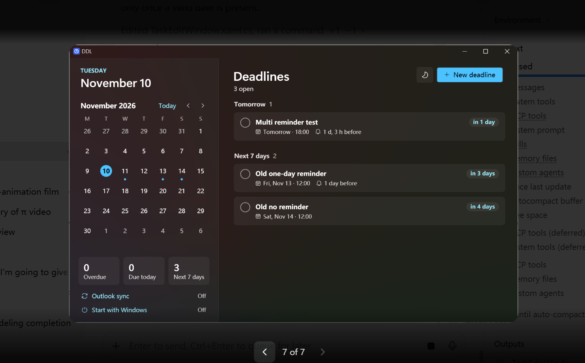
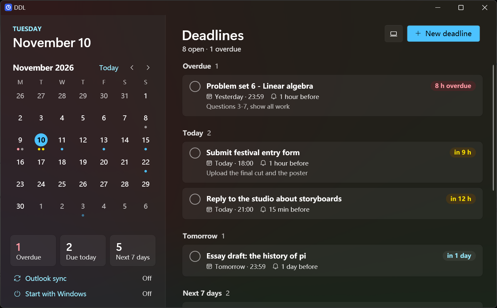
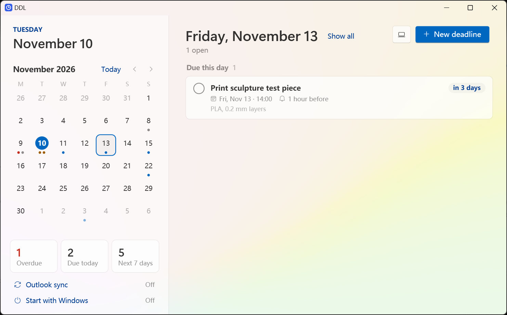
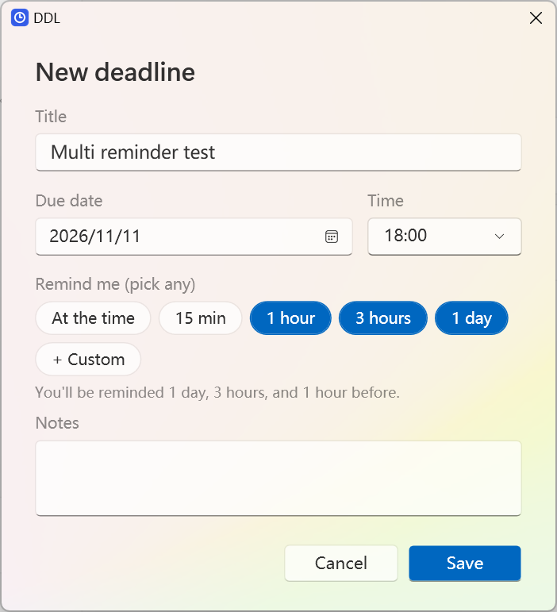

# DDL: deadlines for Windows

A small Windows app for keeping track of deadlines. It has a month calendar, reminders that arrive even when the app is closed, and an optional Outlook calendar that stays in sync.

> **Status: early preview (v0.2).** It works day to day on Windows 11, but it has been tested on one machine and has no automated tests yet. Bug reports are welcome.



## Features

- **Deadlines at a glance.** Grouped into Overdue, Today, Tomorrow, Next 7 days and Later, each with a countdown ("in 3 h", "2 days overdue"). Completed ones fold away.
- **Month calendar.** A dot for every deadline, colored by urgency. Click a day to see only its deadlines; double-click to add one on that day.
- **Reminders that don't need the app running.** Pick any combination (at the time, 15 minutes, 1 hour, 1 day before) or add your own, like 3 days or 45 minutes. Windows delivers them even when DDL is closed, and clicking one opens that deadline.
- **Outlook sync (optional).** Your deadlines appear in their own Outlook calendar and update by themselves. See [Outlook sync](#outlook-sync).
- **Tray icon and Start with Windows.** A red dot on the tray icon while something is overdue. Closing the window keeps DDL in the tray.
- **Taskbar shortcuts.** Right-click the taskbar button for *New deadline* and *Quit DDL*.
- **Windows 11 look.** Fluent design with Mica. Choose Light, Dark or your Windows setting with the button next to *New deadline*.

| Light | Dark |
| --- | --- |
|  |  |
| **A day in the calendar** | **Editing a deadline** |
|  |  |

## Install

1. Download the latest `DDL-<version>-win-x64.zip` from [Releases](../../releases).
2. Unzip it into a folder you'll keep, for example `%LOCALAPPDATA%\Programs\DDL`, and run `DDL.exe`. There is no installer, and you don't need to install .NET.
3. The app isn't code-signed yet, so Windows SmartScreen may warn you the first time: choose **More info → Run anyway**.

Requires Windows 10 version 1809 or later. It looks best on Windows 11.

Tips:
- Pin DDL to the taskbar, and switch on **Start with Windows** in the sidebar so it starts quietly in the tray when you sign in.
- Windows 11 hides new tray icons under **^**. To keep DDL's visible: Settings → Personalization → Taskbar → Other system tray icons → DDL.

## Outlook sync

DDL publishes your deadlines as a calendar file (`.ics`) to a **secret GitHub gist**, and Outlook subscribes to it. It's one-way: you edit in DDL, and Outlook shows the result.

1. In DDL, click **Outlook sync** in the sidebar and tick **Keep the calendar up to date**.
2. Click **Open GitHub**. This creates a classic token with only the `gist` scope. Pick an expiration, generate it, copy it, paste it into DDL and click **Connect**.
3. In Outlook: **Calendar → Add calendar → Subscribe from web**, then paste the address DDL shows and name the calendar.

Good to know:
- Outlook refreshes subscribed calendars on its own schedule, usually every few hours. DDL's own reminders are instant.
- Only titles and times are published, never your notes. A secret gist isn't listed or searchable, but anyone who has its address can read it.
- The token is stored encrypted for your Windows account (DPAPI). **Disconnect** forgets it. The gist stays on GitHub until you delete it.
- Why not OneDrive? OneDrive share links need a cookie exchange that calendar servers don't perform, so Outlook can't read them (checked November 2026).

## Your data

| What | Where |
| --- | --- |
| Deadlines | `%LOCALAPPDATA%\DDL\tasks.json` (plain JSON) |
| Settings | `%LOCALAPPDATA%\DDL\settings.json` |
| Calendar copy (when Outlook sync is on) | `Documents\DDL\DDL deadlines.ics` |

Nothing leaves your PC unless you connect Outlook sync.

## Command line

| Argument | What it does |
| --- | --- |
| *(none)* | Opens DDL, or brings the running copy to the front |
| `--tray` | Starts in the tray without a window (used by Start with Windows) |
| `--new` | Opens the editor for a new deadline |
| `--quit` | Asks the running copy to quit |

Only one copy of DDL runs at a time. Starting it again talks to the running copy.

## Build from source

You need Windows and the [.NET 10 SDK](https://dotnet.microsoft.com/download/dotnet/10.0).

```powershell
git clone https://github.com/Painted-Moon/ddl-deadlines
cd ddl-deadlines
.\build.ps1            # app\DDL.exe (needs the .NET 10 Desktop Runtime to run)
.\build.ps1 -Release   # dist\DDL-<version>-win-x64.zip, self-contained
```

For development:
- `DDL_DATA_DIR=<folder>` uses a separate data folder. Such runs also use their own reminder group and their own single-instance lock, so they never touch your real deadlines or reminders.
- `DDL_THEME=Light` or `Dark` forces a theme.
- `tools/make_icon.py` redraws the app icon (needs Pillow).

Layout: `DDL/Models` (data), `DDL/Services` (storage, reminders, calendar publishing, auto-start), `DDL/ViewModels`, `DDL/Views` (WPF windows and the shared `Theme.xaml`).

## Known limitations

- English interface. The date picker follows your Windows region format.
- Outlook sync is one-way and needs a GitHub account.
- Not code-signed.
- Reminders use `Microsoft.Toolkit.Uwp.Notifications` 7.1.3, which is no longer maintained but still works on Windows 10 and 11.
- If you move `DDL.exe` to another folder after using reminders, open it once from the new place. Reminders scheduled before the move may arrive twice.

## License

[MIT](LICENSE)
